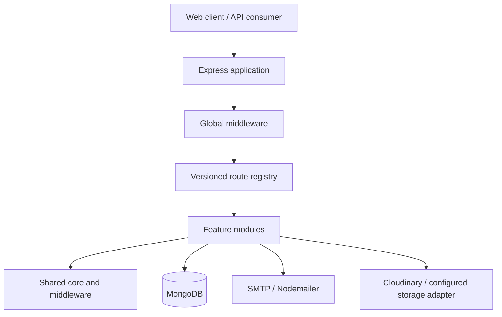

# Ascendra Backend

The backend API for **Ascendra**, a multi-organization training and learning platform. It provides the server-side capabilities for identity and access, organization membership, trainer competency and evidence workflows, explainable trainer matching, training assignments, course delivery, assessments, learning progress, feedback, announcements, notifications, and dashboards.

This repository is an ES-module Node.js application built with Express 5, MongoDB, and Mongoose. It is organized as a modular monolith: feature modules own their business logic while shared infrastructure provides configuration, request validation, errors, responses, logging, and middleware.

> **Documentation status:** Documentation is being maintained against the repository implementation. Where a capability is absent or incomplete, the relevant document identifies that limitation instead of implying that the feature exists.

## At a glance

| Area | Implementation |
|---|---|
| Runtime | Node.js `>=20.19.0` |
| HTTP framework | Express 5 |
| Database | MongoDB through Mongoose |
| Module system | JavaScript ES modules |
| Request validation | Zod |
| Authentication | JWT access tokens and persisted refresh-token sessions |
| Password hashing | bcryptjs |
| Email | Nodemailer |
| File storage integration | Cloudinary package and course-material storage module |
| Security and HTTP middleware | Helmet, CORS, compression, cookie-parser, express-rate-limit |
| Tests | Native Node.js test runner and mongodb-memory-server |
| Linting | ESLint |

## Main capabilities

- Global user identity, authentication, password recovery, and session revocation.
- Multiple organizations with organization-specific memberships and invitations.
- Trainer profiles, eligibility review, competencies, skills, and competency evidence verification.
- Training requirements and configurable, explainable trainer matching.
- Match history and trainer assignment lifecycle management.
- Courses, course materials, enrolments, assessments, and learning progress.
- Organization announcements, feedback, in-app notifications, and administrative dashboards.
- Health endpoints, request correlation IDs, request timeouts, rate limiting, centralized errors, and structured logging.

See [Product overview](docs/01-introduction/project-overview.md) for the business context and [Module index](docs/05-modules/README.md) for feature boundaries.

## Architecture



`src/app.js` configures the HTTP application. `src/server.js` owns database-first startup and process shutdown. `src/routes/index.js` composes feature routers beneath `/api/{API_VERSION}`. Feature modules contain route, controller, validation, service, repository, and model files where applicable.

See [System overview](docs/03-architecture/system-overview.md), [Project structure](docs/03-architecture/project-structure.md), and [Request lifecycle](docs/03-architecture/request-lifecycle.md).

## Quick start

### Prerequisites

- Node.js `20.19.0` or newer.
- npm compatible with the installed Node.js version.
- A MongoDB deployment reachable by the backend. Features that use transactions require a replica set (a local single-node replica set is sufficient for development).
- SMTP credentials if email delivery is to be exercised.
- Cloudinary credentials if Cloudinary-backed course-material storage is to be exercised.

### Install

```bash
npm install
```

Copy the example environment file and fill in required values:

```powershell
# PowerShell
Copy-Item .env.example .env
```

```bash
# macOS / Linux
cp .env.example .env
```

At minimum, configure `CLIENT_URL`, `MONGODB_URI`, `JWT_ACCESS_SECRET`, and `JWT_REFRESH_SECRET`. See [Environment setup](docs/02-getting-started/environment-setup.md) for every variable, defaults, and bootstrap-only values.

### Run locally

```bash
npm run dev
```

The default port is `5000`; the default API prefix is `/api/v1`. The actual values are controlled by `PORT` and `API_VERSION`.

### Initialize the first platform administrator

Configure the `INITIAL_*` bootstrap variables in `.env`, then run:

```bash
npm run bootstrap
```

The bootstrap script creates the initial platform administrator, active Ascendra organization, and approved organization-admin membership in a MongoDB transaction. It is designed to be safe to rerun after a completed bootstrap; conflicting partial records cause it to stop. See [Bootstrap](docs/11-deployment-and-operations/bootstrap.md).

## Common commands

| Command | Purpose |
|---|---|
| `npm run dev` | Start with Nodemon |
| `npm start` | Start the production server |
| `npm test` | Run the test suite |
| `npm run test:watch` | Run tests in watch mode |
| `npm run test:coverage` | Run tests with Node's coverage instrumentation |
| `npm run lint` | Run ESLint |
| `npm run lint:fix` | Apply automatic ESLint fixes |
| `npm run check` | Run lint followed by the full test suite |
| `npm run bootstrap` | Initialize the first platform administrator and organization |

Commands are defined in [package.json](package.json); see [npm scripts](docs/12-reference/npm-scripts.md).

## Documentation

Start at the [documentation home](docs/README.md).

| Audience | Start here |
|---|---|
| New developer | [Project overview](docs/01-introduction/project-overview.md) → [Prerequisites](docs/02-getting-started/prerequisites.md) → [Installation](docs/02-getting-started/installation.md) |
| Backend developer | [System overview](docs/03-architecture/system-overview.md) → [Project structure](docs/03-architecture/project-structure.md) → [Adding a module](docs/10-development-guides/adding-a-new-module.md) |
| API consumer | [API reference](docs/07-api-reference/README.md) |
| Database developer | [Database overview](docs/06-database/database-overview.md) |
| QA engineer | [Testing overview](docs/09-testing/testing-overview.md) |
| Operations | [Deployment overview](docs/11-deployment-and-operations/deployment-overview.md) |

## Security

Never commit `.env` or real credentials. Access-token protected routes require `Authorization: Bearer <access-token>`. Organization-scoped routes also require `X-Organization-Id` and an approved membership in that organization. Review [Security overview](docs/08-security/security-checklist.md) before deploying.

## Contributing

Read [CONTRIBUTING.md](CONTRIBUTING.md) and the [development guides](docs/10-development-guides/README.md) before changing the code. Changes to behavior should include tests and documentation updates.

## License

The repository contains an MIT `LICENSE` file. **There is a metadata inconsistency:** `package.json` currently declares `"license": "ISC"`. Resolve this discrepancy with the project owner before publishing or redistributing the package.
