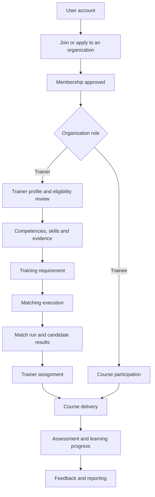

# Product context

## The problem space

Ascendra's domain is organizational training. An organization needs to describe its training needs, identify qualified trainers, allocate trainers to engagements, deliver courses, assess trainees, and observe learning outcomes.

The backend models these concerns as related but separate workflows. For example, a trainer's account, membership in an organization, eligibility approval, and competency evidence are distinct records and decisions.

## Main actors

| Actor | Scope | Responsibility represented in the backend |
|---|---|---|
| Platform Administrator | Platform-wide | Reviews organization applications and manages organization lifecycle; the bootstrap script creates the initial platform admin |
| Organization Administrator | One selected organization | Manages organization-scoped people, trainer approvals, competencies, requirements, matching, assignments, courses and related operational features |
| Trainer | One selected organization | Maintains professional profile and availability; participates in trainer and course workflows |
| Trainee | One selected organization | Joins courses, participates in assessments, tracks learning and submits course feedback |

A person's global account is represented by `User`. Organization-specific role and membership state are represented by `OrganizationMembership`.

## Core business journey

This diagram represents the domain flow at a high level. Individual routes and state transitions are described in the module documents.

## Organization onboarding

An authenticated user can submit an organization application. A platform administrator reviews pending applications and can approve or reject them. The application and organization lifecycle are separate from later membership management.

The organization model also contains settings and optional logo metadata. The actual uploaded asset is stored outside MongoDB; the organization document stores metadata.

## Trainer readiness

A trainer may have an approved organization membership while their trainer profile is still pending review. Trainer approval is a separate eligibility decision. Competency evidence is submitted and reviewed independently, and verified evidence can feed the trainer's derived competency profile.

## Training and learning

Organization administrators create training requirements. The matching subsystem evaluates trainers against those requirements using an organization configuration. A selected trainer can be assigned; assignments have explicit lifecycle states. Courses may be associated with trainers, assignments, and requirements. Trainees enroll, interact with course materials, complete assessments, and generate learning progress records.

## Scope boundaries

The backend source includes modules for feedback, announcements and notifications. This documentation describes the present in-app and API workflows, not an assumed real-time push, mobile delivery, or external event-bus architecture. Any such extension must be verified against future code.

## Related documents

- [Key concepts](key-concepts.md)
- [Module index](../05-modules/README.md)
- [Trainer matching](../05-modules/trainer-matching.md)
- [Learning progress](../05-modules/learning-progress.md)
