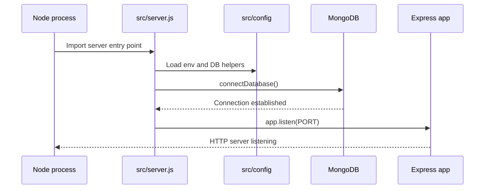
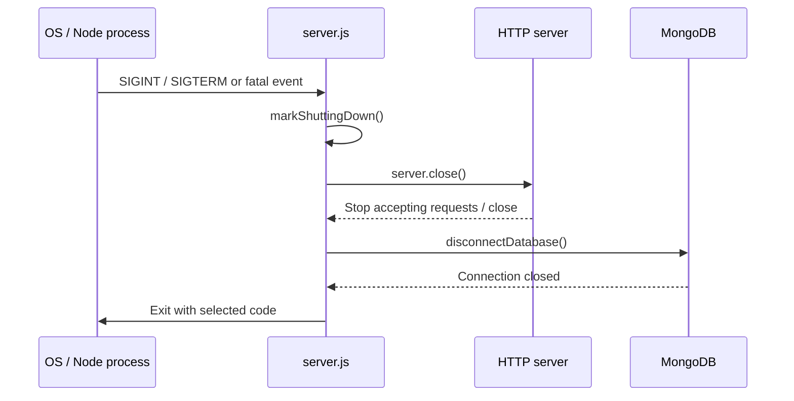

# Application lifecycle

## Separation of responsibilities

`src/app.js` configures the Express application. `src/server.js` owns process and server lifecycle. The database connection is established before the HTTP server begins accepting requests.

## Startup sequence

1. Environment configuration is loaded from `src/config/env.js`.
2. The app module is imported and configured.
3. `startServer()` calls `connectDatabase()`.
4. If the initial database connection succeeds, `app.listen()` starts the HTTP listener.
5. Startup failures are logged and terminate the process with a non-zero exit code.

## MongoDB connection

`src/config/db.js` uses Mongoose with finite server-selection, connection, and socket timeouts. It logs connection lifecycle events and exports:

- `connectDatabase()`
- `disconnectDatabase()`
- `isDatabaseConnected()`

Mongoose manages reconnection after temporary network interruptions; the application still needs to handle operations that fail during outages.

## Shutdown sequence

`src/server.js` handles `SIGINT`, `SIGTERM`, unhandled promise rejections, uncaught exceptions, and HTTP server errors.

A 10-second shutdown timer prevents an indefinitely hanging shutdown. If the timeout fires, the process exits with code 1. Shutdown state prevents concurrent shutdown sequences from running more than once.

## Testing implications

Importing `src/app.js` does not itself start a listener or connect to MongoDB. This separation allows app-level tests to use the Express application without necessarily starting the production server. Server lifecycle behavior is covered by integration tests under `test/integration/core/`.

## Operational caution

Do not run the bootstrap script as part of every application startup. It is a separate, explicit administrative command.
