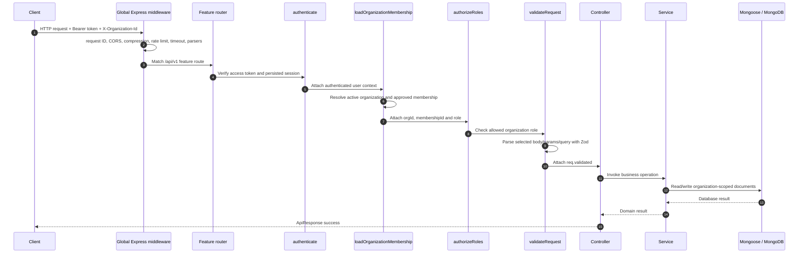

# Request lifecycle

## Global middleware order

The order in `src/app.js` is significant:

1. Disable Express `X-Powered-By`.
2. Helmet security headers (CSP disabled because the service is an API).
3. Request ID assignment.
4. CORS.
5. Response compression.
6. Global rate limiter (15-minute window, maximum 300 requests per client key under the configured default store).
7. Request timeout (30 seconds).
8. JSON body parsing (500 KB limit).
9. URL-encoded body parsing (500 KB limit).
10. Cookie parsing.
11. Versioned feature routers under `/api/{API_VERSION}`.
12. Not-found handler.
13. Centralized error handler.

## Typical protected organization request

The sequence is representative of routes that use all these middleware layers. Public routes, platform-admin routes, and authenticated routes without organization membership have different chains.

## Authentication context

`authenticate` reads `Authorization: Bearer <token>`, verifies the access JWT, checks the persisted session, loads the user, verifies active account status, and checks whether the token predates a password change. It attaches `req.user` with global identity and platform role.

## Organization context

`loadOrganizationMembership` reads `X-Organization-Id`, validates the ObjectId, loads an active organization, finds the user's membership, and requires approved status. It then attaches `orgId`, `membershipId`, and organization `role` to `req.user`.

## Validation

`validateRequest(schema, options)` can validate body, params, query, and headers. Parsed data is stored in `req.validated`. Controllers should use validated values rather than re-reading untrusted request sections.

## Success and failure

Successful controllers use `ApiResponse` helpers. Errors are forwarded to `errorHandler`, which normalizes known Mongoose, duplicate-key, and parsing errors, hides internal error details, logs unexpected failures, and returns the standard error envelope.

## Request IDs

The request ID middleware accepts a syntactically valid UUID from `X-Request-ID` or creates a new UUID. It stores it on `req.requestId` and returns it in the response header and response envelope.
