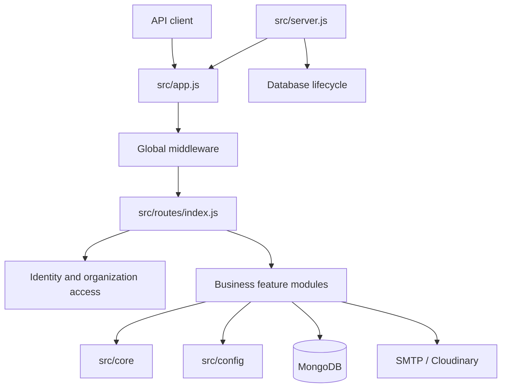

# System overview

## Architectural style

The repository uses a **modular monolith**: one Node.js process exposes a versioned HTTP API, while business capabilities are grouped into modules under `src/modules/`. Modules may contain routes, controllers, validation schemas, services, repositories, domain helpers, and Mongoose models. Shared technical capabilities are centralized rather than reimplemented by each module.

This is a description of the current deployment shape, not a claim that every module is fully independent or that the system is already split into services.

## High-level component diagram

## Application layers

| Layer | Typical responsibility |
|---|---|
| Route | Maps an HTTP method/path to middleware and a controller |
| Middleware | Authentication, organization context, authorization, validation, request infrastructure |
| Controller | Adapts HTTP request/response to a service operation |
| Service | Coordinates business rules and workflows |
| Repository | Encapsulates database query operations where the module uses one |
| Model/schema | Defines persisted document shape, validation, indexes and references |
| Domain helper/engine | Encapsulates calculations or domain-specific transformations |

Not every module has every layer. Some modules call Mongoose from services; others include repositories. Follow the neighboring module's actual pattern rather than introducing layers mechanically.

## Shared infrastructure

- `src/config/`: environment and MongoDB connection lifecycle.
- `src/core/constants/`: HTTP status and application error codes.
- `src/core/errors/`: controlled `AppError`.
- `src/core/responses/`: successful `ApiResponse` helpers.
- `src/core/runtime/`: process/application runtime state.
- `src/core/utils/`: async wrapper, logger, email, organization reference helpers, retry and time formatting.
- `src/middleware/`: request IDs, rate limiting, timeouts, request validation, not-found and error handling.
- `src/routes/`: central route composition.

## External integrations

The dependency list includes Nodemailer and Cloudinary. SMTP delivery is implemented through the email utility. Course-material storage has a storage module and Cloudinary configuration. The repository does not establish a specific cloud hosting provider or distributed event bus.

## Process boundaries

`src/app.js` creates the Express application but does not open the database or start listening. `src/server.js` connects MongoDB first, starts the HTTP listener, and owns process-level shutdown. This separation makes the app easier to test without starting a real listening server.

## Architectural constraints

- Organization-owned data must be scoped by the selected organization.
- Global user identity and organization membership are separate concepts.
- Multi-document workflows that require atomicity need a transaction-capable MongoDB deployment.
- The default rate-limit store is in-memory and therefore is not shared across multiple server instances.
- API contracts are defined by route middleware, Zod schemas, controllers, services and models together; no generated OpenAPI contract is currently established by the source.

## Related documents

- [Architectural decisions](architectural-decisions.md)
- [Project structure](project-structure.md)
- [Application lifecycle](application-lifecycle.md)
- [Request lifecycle](request-lifecycle.md)
- [Database architecture](database-architecture.md)
- [Multi-tenancy](multi-tenancy.md)
