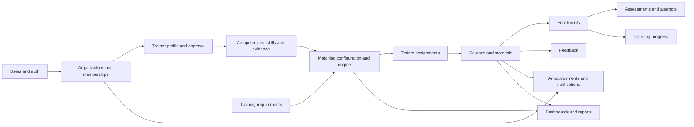

# Business module reference

Ascendra's business logic is organized by domain under `src/modules/`. A module may have its own routes, controllers, validation, services, repositories, models, or domain helpers. Not every module uses every layer.

## Module map

| Domain | Documentation | Main source location |
|---|---|---|
| Authentication | [Authentication](authentication.md) | `src/modules/auth/` |
| Users | [Users](users.md) | `src/modules/auth/user.model.js` |
| Sessions | [Sessions](sessions.md) | `src/modules/sessions/` and auth services |
| Organizations | [Organizations](organizations.md) | `src/modules/organizations/` |
| Memberships | [Organization memberships](organization-memberships.md) | `src/modules/organizationMemberships/` |
| Invitations | [Organization invitations](organization-invitations.md) | `src/modules/organizationInvitations/` |
| Competencies | [Competencies](competencies.md) | `src/modules/competencies/` |
| Skills | [Skills](skills.md) | `src/modules/skills/` |
| Evidence | [Competency evidence](competency-evidence.md) | `src/modules/competencyEvidence/` |
| Trainer profiles | [Trainer profiles](trainer-profiles.md) | `src/modules/trainerProfiles/` |
| Trainer matching | [Trainer matching](trainer-matching.md) | `src/modules/matching/`, `matchingConfig/`, `matchRun/` |
| Matching settings | [Matching configuration](matching-configuration.md) | `src/modules/matchingConfig/` |
| Training needs | [Training requirements](training-requirements.md) | `src/modules/trainingRequirements/` |
| Assignments | [Trainer assignments](trainer-assignments.md) | `src/modules/trainerAssignments/` |
| Courses | [Courses](courses.md) | `src/modules/courses/` |
| Course content | [Course materials](course-materials.md) | `src/modules/courseMaterials/` |
| Enrolment | [Enrollments](enrollments.md) | `src/modules/enrollments/` |
| Assessments | [Assessments](assessments.md) | `src/modules/assessments/` |
| Learning | [Learning progress](learning-progress.md) | `src/modules/learningProgress/` |
| Dashboards | [Dashboards and reporting](dashboards-and-reporting.md) | `src/modules/dashboards/` |
| Feedback | [Feedback](feedback.md) | `src/modules/feedback/` |
| Communications | [Announcements](announcements.md) | `src/modules/announcements/` |
| Notifications | [Notifications](notifications.md) | `src/modules/notifications/` |
| Monitoring | [Health checks](health.md) | `src/modules/health/` |

## How modules interact

The diagram is conceptual. The actual dependency direction and call sites must be confirmed in source before changing a cross-module workflow.

## Module conventions

- Routes define HTTP entry points and middleware order.
- Controllers translate HTTP input/output.
- Services own business rules and workflow orchestration.
- Repositories encapsulate database access where the module has them.
- Models define persistence structure and indexes.
- Validation schemas define accepted request data.
- Domain engines/helpers encapsulate specialized calculations.

See [Adding a new module](../10-development-guides/adding-a-new-module.md) before creating a new feature.
