# Data relationships

The diagram shows major reference relationships visible in the current schemas. It is intentionally conceptual; it does not replace the exact model definitions.

```mermaid
erDiagram
    USER ||--o{ ORGANIZATION_MEMBERSHIP : has
    ORGANIZATION ||--o{ ORGANIZATION_MEMBERSHIP : contains
    ORGANIZATION ||--o{ ORGANIZATION_INVITATION : issues
    USER ||--o{ SESSION : owns
    USER ||--o{ PASSWORD_RESET_TOKEN : receives
    ORGANIZATION ||--o{ TRAINER_PROFILE : scopes
    USER ||--o{ TRAINER_PROFILE : has
    ORGANIZATION ||--o{ COMPETENCY : defines
    ORGANIZATION ||--o{ SKILL : defines
    COMPETENCY }o--o{ SKILL : associated
    TRAINER_PROFILE ||--o{ COMPETENCY_EVIDENCE : supported_by
    TRAINING_REQUIREMENT ||--o{ MATCH_RUN : evaluated_by
    MATCHING_CONFIG ||--o{ MATCH_RUN : snapshotted_in
    MATCH_RUN ||--o{ TRAINER_ASSIGNMENT : informs
    TRAINER_PROFILE ||--o{ TRAINER_ASSIGNMENT : assigned
    COURSE ||--o{ COURSE_MATERIAL : contains
    COURSE ||--o{ ENROLLMENT : has
    ENROLLMENT ||--o{ LEARNING_PROGRESS : tracks
    COURSE ||--o{ ASSESSMENT : evaluates
    ASSESSMENT ||--o{ ASSESSMENT_ATTEMPT : attempted
    COURSE ||--o{ FEEDBACK : receives
    ORGANIZATION ||--o{ ANNOUNCEMENT : publishes
    ORGANIZATION ||--o{ NOTIFICATION : scopes
```

## Relationship notes

- `User` is global; `OrganizationMembership` links a user to an organization and assigns an organization role.
- `TrainerProfile` is organization-specific and is not the same as membership.
- Competency evidence belongs to a trainer profile and can reference competencies and skills.
- Training requirements are evaluated by matching runs. A match run records snapshots so later edits do not rewrite the historical evaluation context.
- A trainer assignment references the requirement, match run, trainer user and trainer profile.
- Courses may reference a trainer, trainer profile, assignment and requirement.
- Enrollment and learning progress are separate: enrollment represents participation; learning progress records material activity.
- Assessment attempts preserve an assessment version snapshot.
- Course feedback is associated with a course, enrollment, trainee and trainer as defined by the schema.

## Integrity caveat

MongoDB ObjectId references are not relational foreign keys. Unless a unique index, schema validator, transaction or service-level reference check exists, a relationship can become inconsistent. Read [Data integrity](data-integrity.md) before changing a reference.
